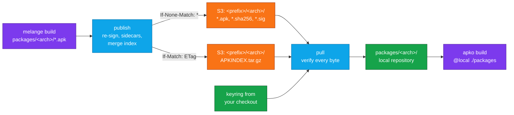

<div align="center">


# APK Repositories in S3 for CircleCI and GitHub Actions

### Build your melange packages once, publish them to a signed repository in S3, and pull them into every apko build.

Publish the APKs melange builds to an S3 bucket as a signed APK repository, then pull them back, verified, as a local repository for apko.<br>
Chainguard-style images on a budget: a bucket, a signing key and your CI.<br>
Concurrent publishes never lose packages · Published packages never change · Trust only your own keyring · No usage data collected

[](https://circleci.com/gh/juburr/apk-repo-orb)
[](https://github.com/juburr/apk-repo-orb/actions/workflows/actions.yml)
[](https://circleci.com/developer/orbs/orb/juburr/apk-repo-orb)
[](LICENSE)
[](https://discuss.circleci.com/c/ecosystem/orbs)


**[Quick Start](#-quick-start)** · **[Features](#-why-apk-repo-orb)** · **[Repository Format](#-repository-format)** · **[CircleCI Commands](#-circleci-commands)** · **[GitHub Actions](#-github-actions)** · **[Bucket Setup](#-bucket-setup)** · **[Security](#-secure-by-design)**

<sub>An unofficial, community-maintained CircleCI orb and set of GitHub Actions. [Contributions are welcome!](#-contributing)</sub>

</div>

<br>

## ✨ Why apk-repo-orb?

<table>
<tr>
<td width="33%" valign="top">
♻️ <b>Build once, reuse everywhere</b><br><br>
Stop rebuilding the same packages from source in every job. <code>publish</code> uploads what <a href="https://github.com/juburr/melange-orb">melange</a> built, re-signed with your production key, and <code>pull</code> hands it to <a href="https://github.com/juburr/apko-orb">apko</a> as a local repository in any later job, on either architecture.
</td>
<td width="33%" valign="top">
🔁 <b>Safe concurrent publishes</b><br><br>
The shared index is replaced with S3 conditional writes (<code>If-Match</code>): when two jobs publish at once, the slower one merges again instead of overwriting. CI runs that race 20 times per change, and every package must end up in the index.
</td>
<td width="33%" valign="top">
🧊 <b>Immutable packages</b><br><br>
Packages and their sidecars are only ever created (<code>If-None-Match: *</code>), never overwritten or deleted. Publishing a different build under a version that already exists fails; publishing the same build again is a no-op.
</td>
</tr>
<tr>
<td width="33%" valign="top">
🔐 <b>Verified before it's used</b><br><br>
Every index and every package is checked against the keyring from your checkout, never a key from the bucket: the index's RSA-SHA256 signature, each package's signed SHA-256 sidecar, and the index's size, checksum and data hash for it. <code>pull</code> moves nothing into place until it all checks out.
</td>
<td width="33%" valign="top">
🛡️ <b>Fails closed</b><br><br>
<code>publish</code> first proves the bucket enforces conditional writes, and refuses to publish to one that doesn't. A 403 is never taken for a missing repository, and legacy SHA-1 signatures are refused.
</td>
<td width="33%" valign="top">
🧾 <b>Receipts</b><br><br>
Each command writes a JSON receipt of exactly what it published, pulled or verified: every package's SHA-256 and size, and the index's ETag and version. Bind it into your build evidence. No usage data of any kind is collected.
</td>
</tr>
</table>

## 🔄 How It Works



1. **`publish`** takes `packages/<arch>/*.apk` from `melange build`, re-signs each package with your production key (`melange sign`), and writes a SHA-256 sidecar for it, signed with the same key. It uploads the new packages and sidecars with `If-None-Match: *`, so nothing that exists is overwritten, then merges them into the bucket's index with `melange index --merge` and uploads that with `If-Match` on the ETag it read. If another publish changed the index in the meantime, it reads it again and merges again.
2. **`pull`** reads the index, verifies its signature with your keyring, and downloads exactly the packages it lists, with their signed sidecars, into a private directory. Once every package checks out, it moves them into `out_dir`, ready for apko as a file-path repository.
3. **`verify`** checks a local repository offline, with no network and no AWS CLI, against your keyring: the same checks `pull` makes.

## 🚀 Quick Start

You need a bucket, an RSA signing key (`melange keygen my-org-apk.rsa`), the public key committed to your repository as the keyring (`keys/my-org-apk.rsa.pub`), the private key in a secret, and AWS credentials that may read and write the repository's prefix. [Bucket Setup](#-bucket-setup) has IAM policies and OIDC trust policies, so no AWS keys need storing.

### CircleCI

Publish from one job, pull into another:

```yaml
version: 2.1

orbs:
  apk-repo: juburr/apk-repo-orb@0.1.0
  apko: juburr/apko-orb@1.1.0
  melange: juburr/melange-orb@1.2.0

jobs:
  publish:
    machine:
      image: ubuntu-2404:current
    steps:
      - checkout
      - melange/install
      - run:
          name: Build Packages
          command: |
            melange keygen build.rsa
            melange build melange.yaml --runner docker --arch "$(uname -m)" \
              --signing-key build.rsa --out-dir packages
      - apk-repo/publish:
          bucket: my-org-apk
          prefix: my-org/os
          keyring: keys
          key_name: my-org-apk.rsa # signs with the PEM key in $APK_SIGNING_KEY
          allow_create: true # only for the first publish to a new prefix
  image:
    machine:
      image: ubuntu-2404:current
    steps:
      - checkout
      - apk-repo/pull:
          bucket: my-org-apk
          prefix: my-org/os
          keyring: keys
          out_dir: packages
      - apko/install
      - apko/build:
          config: apko.yaml
          image: ghcr.io/my-org/app:latest
          arch: host
          output_path: build/app.tar

workflows:
  build:
    jobs:
      - publish:
          context: apk-publishing # APK_SIGNING_KEY and AWS access
      - image:
          requires: [publish]
          context: apk-publishing
```

`apko.yaml` trusts the same key and installs your package from the pulled directory:

```yaml
contents:
  keyring:
    - https://packages.wolfi.dev/os/wolfi-signing.rsa.pub
    - ./keys/my-org-apk.rsa.pub
  repositories:
    - https://packages.wolfi.dev/os
    - '@local ./packages'
  packages:
    - wolfi-baselayout
    - my-package@local
```

> [!TIP]
> The `@local` tag makes apko take `my-package` only from the pulled repository, so a package of the same name elsewhere can't shadow it.

### GitHub Actions

```yaml
jobs:
  publish:
    runs-on: ubuntu-24.04
    permissions:
      contents: read
      id-token: write # for OIDC to AWS
    steps:
      - uses: actions/checkout@3d3c42e5aac5ba805825da76410c181273ba90b1 # v7.0.1
      - uses: juburr/melange-orb/actions/install@v1.2.0
      - run: |
          melange keygen build.rsa
          melange build melange.yaml --runner docker --arch "$(uname -m)" \
            --signing-key build.rsa --out-dir packages
      - uses: aws-actions/configure-aws-credentials@e1253824e5c10ff9df46874f81ed3ec929e19cfd # v6.3.0
        with:
          role-to-assume: ${{ vars.APK_PUBLISH_ROLE_ARN }}
          aws-region: us-east-1
      - uses: juburr/apk-repo-orb/actions/publish@v0.1.0
        env:
          APK_SIGNING_KEY: ${{ secrets.APK_SIGNING_KEY }}
        with:
          bucket: my-org-apk
          prefix: my-org/os
          keyring: keys
          key_name: my-org-apk.rsa
```

`pull` and `verify` work the same way; see [GitHub Actions](#-github-actions).

## 📦 Repository Format

The bucket holds a standard APK v2 repository that `apk` and apko understand, plus signed SHA-256 sidecars. `<prefix>` is a key prefix such as `my-org/os` (no leading or trailing `/`), and `<arch>` is `x86_64` or `aarch64`.

| Key | Written | Content |
| --- | --- | --- |
| `<prefix>/<arch>/APKINDEX.tar.gz` | Replaced, only with `If-Match` on the ETag read | The signed index, with a `.SIGN.RSA256.<key_name>.pub` signature |
| `<prefix>/<arch>/<name>-<version>.apk` | Once (`If-None-Match: *`) | The package, re-signed with the production key |
| `<prefix>/<arch>/<name>-<version>.apk.sha256` | Once | One `sha256sum` line: `<64 hex>  <name>-<version>.apk` |
| `<prefix>/<arch>/<name>-<version>.apk.sha256.<key_name>.sig` | Once | RSA PKCS#1 v1.5 SHA-256 signature of the `.sha256` object's bytes (`openssl dgst -sha256 -sign`) |
| `<prefix>/<key_name>.pub` | Once, with `publish_public_key` | A convenience copy of the public key. Never a trust anchor. |
| `<prefix>/.apk-repo-orb/probe` | Once | Fixed bytes for the conditional write probe |

- **Names.** A package file is always `<name>-<version>.apk`, from its `.PKGINFO`, which is how apko builds its URL. Names match `^[A-Za-z0-9][A-Za-z0-9._+-]*$`, versions `^[0-9A-Za-z._+~-]+-r[0-9]+$`, and each prefix segment `^[A-Za-z0-9][A-Za-z0-9._-]*$`.
- **Keys.** `key_name` matches `^[A-Za-z0-9][A-Za-z0-9._-]*\.rsa$`, such as `my-org-apk.rsa`, and consumers' keyring file is named `<key_name>.pub`: apko finds the key for `.SIGN.RSA256.my-org-apk.rsa.pub` by that name.
- **Signatures.** Only `.SIGN.RSA256.` (SHA-256) signatures are written or accepted; a legacy SHA-1 `.SIGN.RSA.` index fails verification.
- **Why sidecars.** The index's per-package checksum (`C:`) is SHA-1 of the package's control segment. The sidecar gives each whole file a SHA-256, signed with the same key, and keeps the index the only object that ever changes. Its signature is named after the key, so after a key rotation new signatures can sit beside old ones.
- **Metadata.** Immutable objects get `Content-Type: application/octet-stream` and `Cache-Control: max-age=31536000, immutable`; the index gets `application/gzip` and `no-cache`.
- **Invariant.** Every package an index lists has its `.apk`, `.sha256` and a `.sig` in the bucket, since they are uploaded first. Objects no index lists (left by an interrupted publish) are allowed and ignored. The next publish of the same build adopts such a package when it is the same package signed with `key_name` alone; anything else at that key makes the version unusable, since nothing is ever overwritten.

## ⬆️ Publishing

`publish` runs these steps for each architecture in `packages_dir` (or in `arch`):

1. **Checks before any write.** Every name, version, prefix and key name is validated. The private key in `$APK_SIGNING_KEY` must match the keyring's `<key_name>.pub`. melange, the AWS CLI (2.22.5 or newer, the first whose `put-object` takes `--if-match`), python3 and openssl must be on the `PATH`. A package over 5 GiB is refused, since multipart uploads aren't supported yet.
2. **Prepares the packages** in a private directory; `packages_dir` is never modified, and melange's own `APKINDEX.tar.gz` there is ignored. Each package must be named `<name>-<version>.apk` and be built for its directory's architecture. With `resign` (the default), `melange sign` replaces melange's build-time signature with the production key's, and the result must carry that signature alone.
3. **Probes the bucket.** It writes `<prefix>/.apk-repo-orb/probe` with fixed bytes and `If-None-Match: *`, writes it again (which must fail with 412), and writes it with an `If-Match` that can't match (which must fail with 412 too). If either succeeds, the bucket ignores conditional writes and `publish` stops: `ERROR: <endpoint> does not enforce S3 conditional writes; refusing to publish`. The writes never change the object.
4. **Reads the index** and verifies it with the keyring. A missing index is an error unless `allow_create` is set, so a mistyped prefix never starts a new repository. Access denied (403) is always an error, never "no repository".
5. **Sorts the packages.** A package the index doesn't list is new. One it lists must be the same package: the same bytes, or the same control and data segments signed differently. Anything else fails: published packages never change, so publish a new build under a new version or epoch (`-r<N>`).
6. **Uploads the new packages and sidecars** with `If-None-Match: *`, before the index, so no index ever lists a package that isn't there.
7. **Merges and uploads the index.** `melange index --merge` writes the new index, signed with the production key. `publish` checks that it lists exactly the old entries, unchanged, plus the new ones, then uploads it with `If-Match` on the ETag read in step 4 (or `If-None-Match: *` when creating). On 412 or 409, another publish got there first: it waits (with jittered backoff), reads the index again and merges again, up to `max_attempts` times.

Architectures are published independently: one that fails doesn't undo another, and the step fails naming the ones that did. `dry_run` does everything but write, and reports what it would publish. The receipt (below) is written only when everything succeeds.

> [!NOTE]
> Publishing the same build twice is a no-op, so a re-run job is safe. A job that died after uploading packages but before the index leaves orphans; publishing the same build again adopts them. `dry_run` reports an orphan it couldn't adopt, just as a real run would fail on it.

## ⬇️ Pulling and Verifying

`pull` never lists the bucket. For each architecture it reads `<prefix>/<arch>/APKINDEX.tar.gz` and verifies its signature with the keyring, then fetches each package it lists, with its `.sha256` sidecar and the sidecar's signatures by keyring keys, into a private staging directory. Every package must match its signed sidecar's SHA-256 and the index's size, checksum (`C:`) and data hash. Only when everything verifies does it move the repository into `out_dir/<arch>`, which must not exist yet or be empty. A missing index is an error ("There is no repository at …"), never an empty repository.

With `cache_dir`, a package from an earlier pull is reused when its SHA-256 matches its signed sidecar, and new packages are added. Save and restore it with `save_cache` and `restore_cache` (or `actions/cache`).

`verify` makes the same checks on a local directory, offline, and warns about files the index doesn't list. Use it on what `pull` wrote in another job, or on a repository you copied by other means.

### Receipts

Every command writes JSON to `receipt_path` (default `apk-repo-receipt.json`) and exports its absolute path as `APK_REPO_RECEIPT`; the GitHub Actions also return it as the `receipt` output. Keys are stable within `schema_version` 1:

```json
{
  "schema_version": 1,
  "tool": "apk-repo-orb",
  "tool_version": "0.1.0",
  "operation": "publish",
  "dry_run": false,
  "backend": "s3",
  "endpoint_url": "",
  "bucket": "my-org-apk",
  "prefix": "my-org/os",
  "key_name": "my-org-apk.rsa",
  "started": "2026-10-27T12:00:00Z",
  "finished": "2026-10-27T12:00:09Z",
  "architectures": {
    "x86_64": {
      "index": {
        "key": "my-org/os/x86_64/APKINDEX.tar.gz",
        "sha256": "<64 hex>",
        "etag": "\"<ETag as S3 returned it>\"",
        "version_id": null,
        "signature": ".SIGN.RSA256.my-org-apk.rsa.pub"
      },
      "packages": [
        {"name": "my-package", "version": "1.2.3-r0", "file": "my-package-1.2.3-r0.apk", "sha256": "<64 hex>", "size": 1234567}
      ],
      "published": ["my-package-1.2.3-r0.apk"],
      "skipped_identical": [],
      "attempts": 1
    }
  }
}
```

`packages` lists every package in the resulting (publish) or verified (pull, verify) index. `published`, `skipped_identical` and `attempts` appear for `publish` only. `version_id` is set in a versioned bucket. For `verify`, `index.key` is the local path, and `backend`, `endpoint_url`, `bucket`, `prefix` and `key_name` are `null`. Receipts never hold credentials or key material.

## 🧰 CircleCI Commands

Every command exits 0 on success, 1 on a failure (a bad signature, a refused write) and 2 for a usage error (a bad parameter), and prints `ERROR:` lines naming the object, the operation and the fix where one is known. Environment variables are expanded in string parameters.

### `apk-repo/publish`

Publishes `packages_dir/<arch>/*.apk` to the repository at `s3://<bucket>/<prefix>`, as described in [Publishing](#️-publishing). Run `melange-orb/install` first.

| Parameter | Default | Description |
| --- | --- | --- |
| `bucket` | (required) | The bucket that holds the repository. |
| `prefix` | (required) | The repository's key prefix, such as `my-org/os`. |
| `keyring` | (required) | Space-separated public key files (`<key>.rsa.pub`) or directories of them, from your checkout. Must hold `<key_name>.pub` and the key that signed the bucket's index. |
| `key_name` | (required) | The signing key's name, such as `my-org-apk.rsa`. |
| `signing_key` | `APK_SIGNING_KEY` | Name of the environment variable holding the PEM private key (or the PEM base64-encoded), never the key itself. |
| `packages_dir` | `packages` | melange's `--out-dir`. Never modified. |
| `arch` | `""` | `x86_64` and/or `aarch64`, space-separated. Empty publishes every `packages_dir/<arch>` that holds packages. |
| `allow_create` | `false` | Create the repository when an architecture has no index yet. |
| `resign` | `true` | Re-sign each package with the production key. |
| `max_attempts` | `5` | How many times to merge and upload an index that another publish keeps changing. |
| `publish_public_key` | `false` | Also upload `<prefix>/<key_name>.pub`, a convenience copy. |
| `s3_checksums` | `true` | Send each upload's SHA-256 for S3 to check. See [S3-compatible services](#s3-compatible-services). |
| `dry_run` | `false` | Read, verify and prepare everything, write nothing, and report what would be published. |
| `endpoint_url` | `""` | An S3-compatible service's endpoint: `https://`, or `http://` to localhost. Empty is AWS. |
| `region` | `""` | The bucket's region. Empty leaves it to the AWS CLI (`AWS_REGION`, its config). |
| `backend` | `s3` | Only `s3` for now. |
| `receipt_path` | `apk-repo-receipt.json` | Where to write the receipt. |

### `apk-repo/pull`

Downloads the repository into `out_dir`, verified, as described in [Pulling and Verifying](#️-pulling-and-verifying).

| Parameter | Default | Description |
| --- | --- | --- |
| `bucket` | (required) | The bucket that holds the repository. |
| `prefix` | (required) | The repository's key prefix. |
| `keyring` | (required) | Space-separated public key files (`<key>.rsa.pub`) or directories of them, from your checkout. A key is never taken from the bucket. |
| `arch` | `""` | `x86_64` and/or `aarch64`, space-separated. Empty is the machine's own (`uname -m`). |
| `out_dir` | `packages` | Where to put the repository. Each `out_dir/<arch>` must not exist yet, or be empty. |
| `cache_dir` | `""` | A directory of packages from earlier pulls, reused when they match their signed sidecars. Empty caches nothing. |
| `endpoint_url` | `""` | An S3-compatible service's endpoint. Empty is AWS. |
| `region` | `""` | The bucket's region. |
| `backend` | `s3` | Only `s3` for now. |
| `receipt_path` | `apk-repo-receipt.json` | Where to write the receipt. |

### `apk-repo/verify`

Verifies a local repository offline, with no network and no AWS CLI.

| Parameter | Default | Description |
| --- | --- | --- |
| `keyring` | (required) | Space-separated public key files (`<key>.rsa.pub`) or directories of them, from your checkout. |
| `dir` | `packages` | The repository directory, holding `<arch>/APKINDEX.tar.gz` and the packages. |
| `arch` | `""` | `x86_64` and/or `aarch64`, space-separated. Empty is the machine's own. |
| `receipt_path` | `apk-repo-receipt.json` | Where to write the receipt. |

## ⚡ GitHub Actions

Each command has a GitHub Action of the same name. The actions run the same scripts as the orb and take the same inputs with the same defaults, and each returns a `receipt` output: the receipt's absolute path.

| Action | Orb command |
| --- | --- |
| `juburr/apk-repo-orb/actions/publish` | [`apk-repo/publish`](#apk-repopublish) |
| `juburr/apk-repo-orb/actions/pull` | [`apk-repo/pull`](#apk-repopull) |
| `juburr/apk-repo-orb/actions/verify` | [`apk-repo/verify`](#apk-repoverify) |

```yaml
      - uses: aws-actions/configure-aws-credentials@e1253824e5c10ff9df46874f81ed3ec929e19cfd # v6.3.0
        with:
          role-to-assume: ${{ vars.APK_PULL_ROLE_ARN }}
          aws-region: us-east-1
      - id: pull
        uses: juburr/apk-repo-orb/actions/pull@v0.1.0
        with:
          bucket: my-org-apk
          prefix: my-org/os
          keyring: keys
      # pull has verified it already; verify checks a copy offline, such as
      # one a later job received as an artifact.
      - uses: juburr/apk-repo-orb/actions/verify@v0.1.0
        with:
          dir: packages
          keyring: keys
          receipt_path: verify-receipt.json
      - uses: juburr/apko-orb/actions/install@v1.1.0
      - uses: juburr/apko-orb/actions/build@v1.1.0
        with:
          config: apko.yaml
          image: ghcr.io/my-org/app:latest
          output_path: build/app.tar
      - run: cat "${RECEIPT}"
        env:
          RECEIPT: ${{ steps.pull.outputs.receipt }}
```

How they differ from the orb's commands:

- **Versions.** Reference an action by the repository's release tag, such as `v0.1.0`, the tag the orb is published from, or for the strongest pinning by that tag's commit SHA: `juburr/apk-repo-orb/actions/publish@<sha> # v0.1.0`.
- **The signing key.** `signing_key` names an environment variable, as in the orb. Set it on the step from a secret (`env: APK_SIGNING_KEY: ${{ secrets.APK_SIGNING_KEY }}`), so it never appears as an input.
- **Environment variables.** The orb expands `$NAME` in string parameters with the CircleCI CLI, which GitHub's runners don't have, so the actions take values as they are. Use GitHub's expressions instead.
- **Runners.** GitHub-hosted `ubuntu-24.04` and `ubuntu-24.04-arm` runners have everything the actions need, and CI runs every action on both.

The actions are composite actions in [`actions/`](actions). Each passes its inputs to the orb's script as environment variables, and [`actions/run_script.sh`](actions/run_script.sh) gives the script what CircleCI would: the helpers it includes, and a `BASH_ENV` file whose exports it passes on through `GITHUB_ENV`.

## 🪣 Bucket Setup

Copy these and replace `my-org-apk` (the bucket), `my-org/os` (the prefix) and `111122223333` (your account). The orb creates no cloud resources.

### IAM policy for `pull`

`pull` only reads. `s3:ListBucket` isn't used to list anything: without it, S3 answers 403 instead of 404 for a key that doesn't exist, and `pull` can't tell a missing repository from a forbidden one.

```json
{
  "Version": "2012-10-17",
  "Statement": [
    {
      "Effect": "Allow",
      "Action": "s3:GetObject",
      "Resource": "arn:aws:s3:::my-org-apk/my-org/os/*"
    },
    {
      "Effect": "Allow",
      "Action": "s3:ListBucket",
      "Resource": "arn:aws:s3:::my-org-apk",
      "Condition": {"StringLike": {"s3:prefix": "my-org/os/*"}}
    }
  ]
}
```

> [!NOTE]
> If a missing index still comes back as 403 (`Access … was denied`), grant `s3:ListBucket` on the bucket without the `s3:prefix` condition.

### IAM policy for `publish`

The `pull` policy plus `s3:PutObject` on the prefix. Grant no `s3:DeleteObject` and no `s3:PutObjectAcl`: the orb never deletes or changes ACLs.

```json
{
  "Version": "2012-10-17",
  "Statement": [
    {
      "Effect": "Allow",
      "Action": ["s3:GetObject", "s3:PutObject"],
      "Resource": "arn:aws:s3:::my-org-apk/my-org/os/*"
    },
    {
      "Effect": "Allow",
      "Action": "s3:ListBucket",
      "Resource": "arn:aws:s3:::my-org-apk",
      "Condition": {"StringLike": {"s3:prefix": "my-org/os/*"}}
    }
  ]
}
```

### Bucket policy (recommended)

Defense in depth, so that no client, this orb or another, can overwrite a package. It uses the condition keys from AWS's [Enforce conditional writes on Amazon S3 buckets](https://docs.aws.amazon.com/AmazonS3/latest/userguide/conditional-writes-enforce.html). The first statement denies any write without `If-None-Match` (so objects can be created, never replaced) everywhere except the indexes and the probe object. The second denies writes to those with neither `If-None-Match` nor `If-Match`. `s3:ObjectCreationOperation` exempts the parts of multipart uploads, as AWS's examples do. It assumes the bucket holds only APK repositories.

```json
{
  "Version": "2012-10-17",
  "Statement": [
    {
      "Sid": "CreateOnlyExceptIndexes",
      "Effect": "Deny",
      "Principal": "*",
      "Action": "s3:PutObject",
      "NotResource": [
        "arn:aws:s3:::my-org-apk/*/APKINDEX.tar.gz",
        "arn:aws:s3:::my-org-apk/*/.apk-repo-orb/probe"
      ],
      "Condition": {
        "Null": {"s3:if-none-match": "true"},
        "Bool": {"s3:ObjectCreationOperation": "true"}
      }
    },
    {
      "Sid": "ConditionalIndexWrites",
      "Effect": "Deny",
      "Principal": "*",
      "Action": "s3:PutObject",
      "Resource": [
        "arn:aws:s3:::my-org-apk/*/APKINDEX.tar.gz",
        "arn:aws:s3:::my-org-apk/*/.apk-repo-orb/probe"
      ],
      "Condition": {
        "Null": {"s3:if-none-match": "true", "s3:if-match": "true"},
        "Bool": {"s3:ObjectCreationOperation": "true"}
      }
    }
  ]
}
```

With this policy, copy operations (`CopyObject`) into the bucket fail, as AWS's page explains.

### Versioning and lifecycle

Turn on **versioning**: an index replaced by mistake can be restored, and receipts record each index's `version_id`. Add a lifecycle rule that **aborts incomplete multipart uploads** after a day. [Object Lock](https://docs.aws.amazon.com/AmazonS3/latest/userguide/object-lock.html) can also keep every object version from being deleted or overwritten for a retention period; with a default retention, that includes each superseded version of the index.

### OIDC: no stored AWS keys

The orb uses the AWS CLI's standard credential chain (environment, profiles, web identity) and never takes credentials as parameters.

**GitHub Actions.** Create an IAM OIDC provider for `token.actions.githubusercontent.com`, then a role trusting it for one repository and branch:

```json
{
  "Effect": "Allow",
  "Principal": {"Federated": "arn:aws:iam::111122223333:oidc-provider/token.actions.githubusercontent.com"},
  "Action": "sts:AssumeRoleWithWebIdentity",
  "Condition": {
    "StringEquals": {
      "token.actions.githubusercontent.com:aud": "sts.amazonaws.com",
      "token.actions.githubusercontent.com:sub": "repo:my-org/my-repo:ref:refs/heads/main"
    }
  }
}
```

Give the job `permissions: id-token: write` and use `aws-actions/configure-aws-credentials@e1253824e5c10ff9df46874f81ed3ec929e19cfd # v6.3.0` with `role-to-assume`, as in the [Quick Start](#github-actions).

**CircleCI.** Create an IAM OIDC provider for `oidc.circleci.com/org/<ORG_ID>` (audience `<ORG_ID>`, your organization's ID), then a role trusting it for one project and branch. `$CIRCLE_OIDC_TOKEN_V2` carries the repository and branch in its `sub`:

```json
{
  "Effect": "Allow",
  "Principal": {"Federated": "arn:aws:iam::111122223333:oidc-provider/oidc.circleci.com/org/<ORG_ID>"},
  "Action": "sts:AssumeRoleWithWebIdentity",
  "Condition": {
    "StringEquals": {"oidc.circleci.com/org/<ORG_ID>:aud": "<ORG_ID>"},
    "StringLike": {
      "oidc.circleci.com/org/<ORG_ID>:sub": "org/<ORG_ID>/project/<PROJECT_ID>/user/*/vcs-origin/github.com/my-org/my-repo/vcs-ref/refs/heads/main"
    }
  }
}
```

Put the role's ARN in `AWS_ROLE_ARN` and the region in `AWS_REGION` in a context (CircleCI only issues OIDC tokens to jobs that use a context), then hand the token to the AWS CLI before the orb's steps:

```yaml
      - run:
          name: Use the job's OIDC token for AWS
          command: |
            printf '%s' "${CIRCLE_OIDC_TOKEN_V2}" > /tmp/aws-web-identity-token
            printf 'export AWS_WEB_IDENTITY_TOKEN_FILE=%q\n' /tmp/aws-web-identity-token >> "${BASH_ENV}"
```

The [`circleci/aws-cli`](https://circleci.com/developer/orbs/orb/circleci/aws-cli) orb's `aws-cli/setup` with `role_arn` does the same.

### Serving over HTTPS later

The orb is a CI-side client; nothing serves the bucket. Should you want apko to fetch from it directly, put a CDN with an authentication check in front of the private bucket (a CloudFront Function checking basic auth, or a Cloudflare Worker in front of R2) and point apko at `https://<host>/<prefix>`, with `HTTP_AUTH=basic:<host>:<user>:<password>`. That variable takes exactly four colon-separated fields, so the host can't include a port and the password can't contain `:`. The objects' `Cache-Control` headers are already what a CDN needs: packages are immutable, and the index is never served stale.

### S3-compatible services

Set `endpoint_url`. When it is empty and the AWS CLI would take an endpoint from `AWS_ENDPOINT_URL_S3` or `AWS_ENDPOINT_URL`, the orb uses that one instead, checks it the same way (`https://`, or `http://` to localhost), and names it in the receipt; an `endpoint_url` in an AWS CLI profile isn't seen. CI tests against [versitygw](https://github.com/versity/versitygw) v1.10.0, which enforces both conditions atomically, and the orb is built on Amazon S3's documented behavior; no test runs against Amazon S3 itself yet. Other services may work if `publish`'s probe passes, and it refuses those that ignore conditional writes. Services known to ignore them on `PutObject` include Garage, Zenko CloudServer and `rclone serve s3`.

The AWS CLI computes a CRC checksum for every upload by default, and `publish` also sends each upload's SHA-256 (`s3_checksums`). For a service that rejects checksum headers, set `s3_checksums: false` and these AWS CLI settings in the job's environment:

```yaml
environment:
  AWS_REQUEST_CHECKSUM_CALCULATION: when_required
  AWS_RESPONSE_CHECKSUM_VALIDATION: when_required
```

## 🔒 Secure by Design

- **Trust only your keyring.** Signatures are checked against public keys from your checkout. A key from the bucket is never trusted, not even the one `publish_public_key` uploads.
- **Verify before use.** `publish` verifies the bucket's index, and the sidecar of every package the new index lists, before it writes the index; `pull` verifies everything before anything reaches `out_dir`. An index's contents are only read once its signature verifies. Only RSA-SHA256 signatures by RSA keys are accepted. A sidecar needs one signature by a keyring key that verifies; one by another keyring key that doesn't is reported with a warning, since an immutable stray signature must not make a package unreadable for good.
- **Nothing is deleted or overwritten.** The orb's only write is `aws s3api put-object` with `If-None-Match` or `If-Match`; it never calls `aws s3 cp`/`sync`, `delete-object` or any other mutating API. A test fails the build if one appears.
- **The signing key.** It is passed only as the name of an environment variable. `publish` writes it to a private file (mode 0600, in a directory created with mode 0700) that the step removes when it ends, even after a failure, then unsets the variable, so the AWS CLI and melange never inherit it. It is never logged, put on a command line or written to a receipt, and scripts never enable xtrace. An encrypted key fails at once rather than prompting. On GitHub Actions, the shared `actions/run_script.sh` also snapshots the step's environment, key included, into its own private temporary directory to find what the script exported, and removes it when the step ends.
- **Untrusted archives.** Indexes and packages are parsed in memory with size limits; no path from an archive is ever written to disk.
- **Least privilege.** No `sudo`, no AWS credential parameters (the CLI's standard chain, ideally [OIDC](#oidc-no-stored-aws-keys)), and no network access beyond the S3 endpoint and AWS STS.
- **Privacy.** No usage data of any kind is collected or shipped back to the orb developer.

### Rotating the signing key

1. Add the new `<new>.rsa.pub` to every keyring: consumers' and `publish`'s.
2. Switch `key_name` and `APK_SIGNING_KEY` to the new key. Each architecture's next publish signs the index with it. Packages published before keep their embedded signature, which apko doesn't check, and a sidecar signed with the old key only.
3. Optionally, sign the old packages' sidecars with the new key and upload the signatures as `<name>-<version>.apk.sha256.<new>.sig`, new objects beside the old ones (`If-None-Match: *`). There is no command for this in v0.1.0.
4. Remove the old key from keyrings only once every index is signed with the new key and every package has a sidecar signature by it: `pull` and `verify` refuse a package without a sidecar signature by a keyring key.

### What signatures can't tell you

- **Freshness.** An index's signature proves who signed it, not that it is the latest. Someone who can write the bucket can put back an older signed index, or another prefix's index signed with the same key, and `pull` accepts it. Keep write access to the publishing role, turn on versioning, and compare the `etag` and `version_id` in receipts when it matters.
- **The index's signature member.** As in every APK repository, the signature covers everything after the index's first gzip member, not that member's own header, so the index file's SHA-256 in a receipt identifies the bytes read, not a signed value. The packages are covered whole by their signed sidecars.

> [!IMPORTANT]
> **Info for security teams:** see [Network Access](#-network-access) for the hosts to allow on locked-down or self-hosted runners.

## 💻 Supported Platforms

Linux on `x86_64` and `aarch64`, including CircleCI's `arm.medium` machines and GitHub's `ubuntu-24.04-arm` runners. Repositories hold `x86_64` and `aarch64` packages, whatever the machine.

| Tool | Needed by | Notes |
| --- | --- | --- |
| bash 4+, coreutils, GNU tar and gzip | all | |
| python3 3.8+ (standard library only) | all | Splits and parses the APK archives' gzip segments, which bash can't do robustly, and writes receipts |
| `openssl` CLI | all | RSA-SHA256 signatures |
| AWS CLI v2, 2.22.5 or newer | `pull`, `publish` | The first release whose `put-object` takes `--if-match` |
| melange 0.61.2 or newer | `publish` | `melange sign` and `melange index`; install it with [melange-orb](https://github.com/juburr/melange-orb) |

The orb installs none of them. CircleCI's `ubuntu-2404` machine images and GitHub's `ubuntu-24.04` runners have all but melange. `cimg/base` has bash, python3 and openssl, so `verify` runs there, but not the AWS CLI: install it in an earlier step (for example with the [`circleci/aws-cli`](https://circleci.com/developer/orbs/orb/circleci/aws-cli) orb) to `pull` or `publish` there. CI runs the commands on amd64 and arm64 machine executors and runners, with melange 0.61.2 and 0.63.1, and the offline tests on `cimg/base` and on Python 3.8.

## 🌐 Network Access

Hosts to allow (HTTPS, port 443) on a locked-down or self-hosted runner:

| Host | Needed by | Purpose |
| --- | --- | --- |
| `<bucket>.s3.<region>.amazonaws.com`, `s3.<region>.amazonaws.com` | `pull`, `publish` | The bucket, or the host in `endpoint_url` for an S3-compatible service |
| `sts.<region>.amazonaws.com` or `sts.amazonaws.com` | `pull`, `publish` | Only when the AWS CLI's credentials come from web identity (OIDC) or an assumed role |

`verify` needs no network at all, and `melange sign` and `melange index` work offline. The orb sends nothing anywhere else.

## 🤝 Contributing

This is an unofficial, community-maintained orb, and contributions are welcome! Bug reports, feature ideas and pull requests all help.

- **Found a bug or have an idea?** [Open an issue](https://github.com/juburr/apk-repo-orb/issues).
- **Before opening a pull request**, run `yamllint .`, `shellcheck src/scripts/*.sh src/scripts/lib/*.sh actions/*.sh tests/*.sh`, and every offline test: `bash tests/commands_test.sh`, `bash tests/wiring_test.sh`, `bash tests/actions_test.sh`, `bash tests/env_subst_test.sh` and `bash tests/shell_conventions_test.sh`. They need only bash, python3 and openssl: stand-ins replace the AWS CLI (a bucket in a local directory that can answer 403, 404, 409 and 412 or ignore conditions) and melange.
- **With Docker, melange and the AWS CLI,** run what CI runs against a real server: `bash tests/s3_server.sh apk-repo-test`, then `APK_REPO_BUCKET=apk-repo-test bash tests/integration_test.sh`, and `bash tests/golden_test.sh` for melange's own output. `tests/s3_server.sh` needs `AWS_ACCESS_KEY_ID` and `AWS_SECRET_ACCESS_KEY` set to any test values.

CI lints and packs the orb and runs ShellCheck and the offline tests. Then it runs the golden tests with real melange, the integration and race tests against versitygw, and an end-to-end build on amd64 and arm64: melange builds a package, `publish` uploads it, `pull` fetches it, `verify` checks it, and apko builds an image from it that must run. A GitHub workflow ([`.github/workflows/actions.yml`](.github/workflows/actions.yml)) runs the same with the GitHub Actions on GitHub's runners.

## 🎨 Logo

Need the logo for a slide deck, blog post, or internal developer portal? PNGs with transparent backgrounds are in [`assets/logos`](assets/logos): [64](assets/logos/apk-repo-orb-64px.png) · [128](assets/logos/apk-repo-orb-128px.png) · [256](assets/logos/apk-repo-orb-256px.png) · [512](assets/logos/apk-repo-orb-512px.png) · [1024](assets/logos/apk-repo-orb-1024px.png) px

## 📜 License

[MIT](LICENSE) © 2026 Justin Burr

<br>

<div align="center">
  
  <br>
  <sub>Build once, publish signed, pull verified. If this orb helps your team, a ⭐ helps others find it.</sub>
  <br>
  <sub><a href="#apk-repositories-in-s3-for-circleci-and-github-actions">Back to top ↑</a></sub>
</div>
